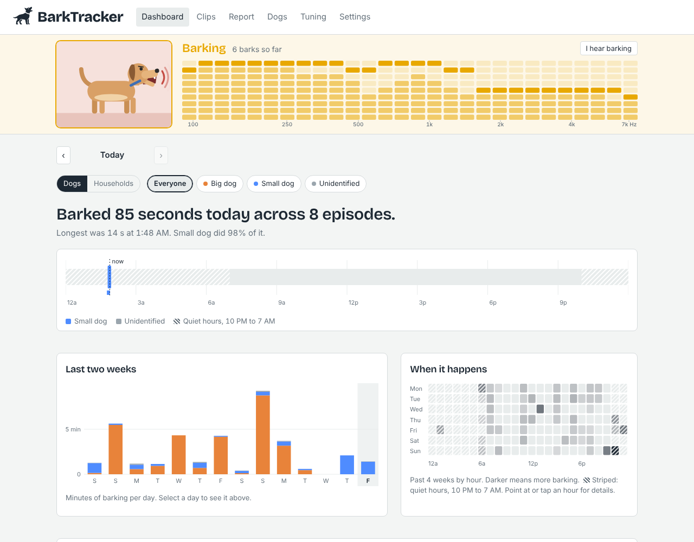
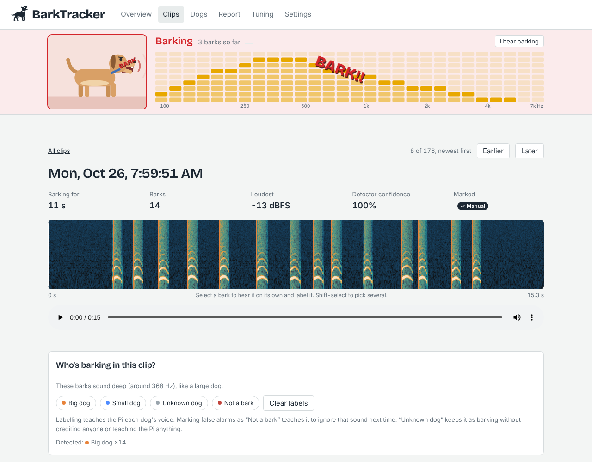
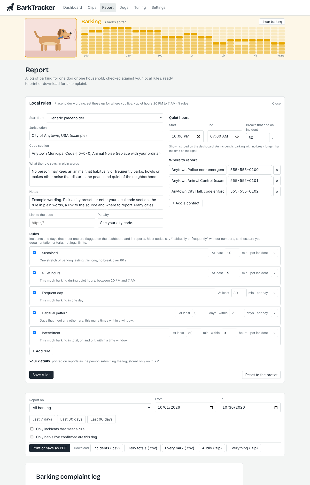
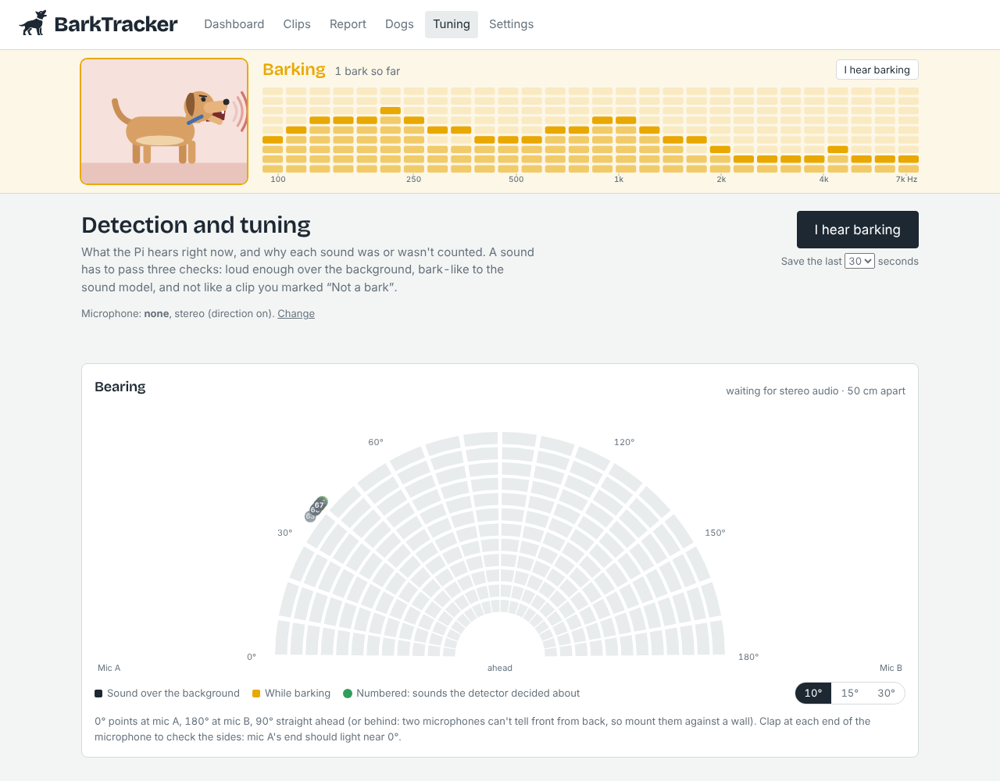
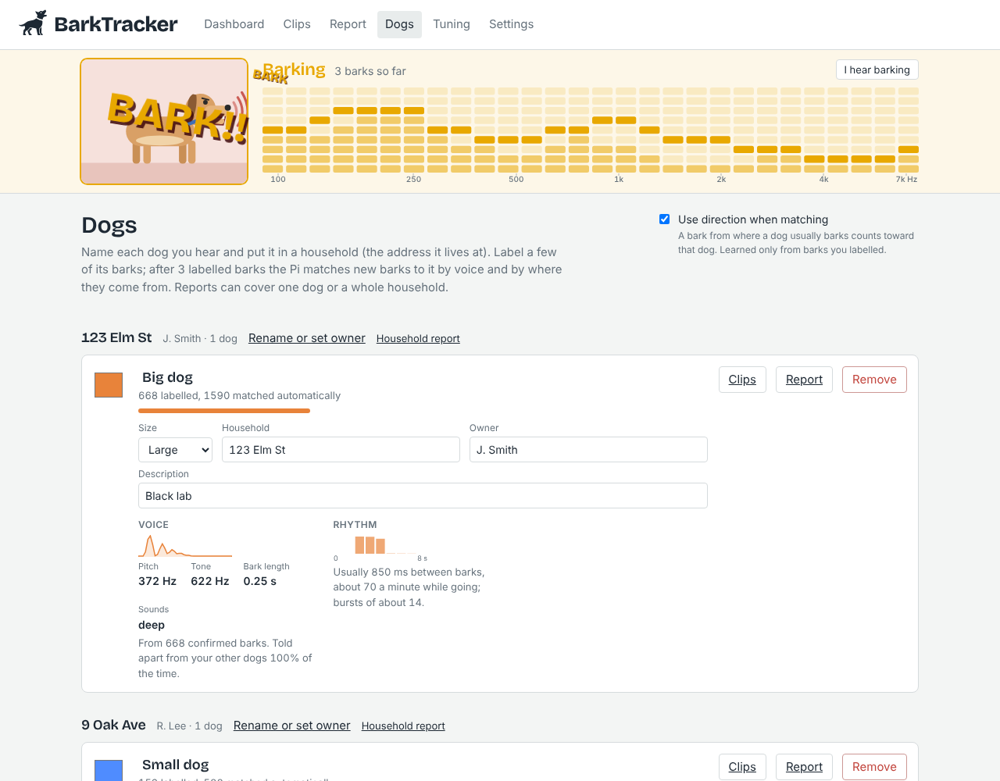
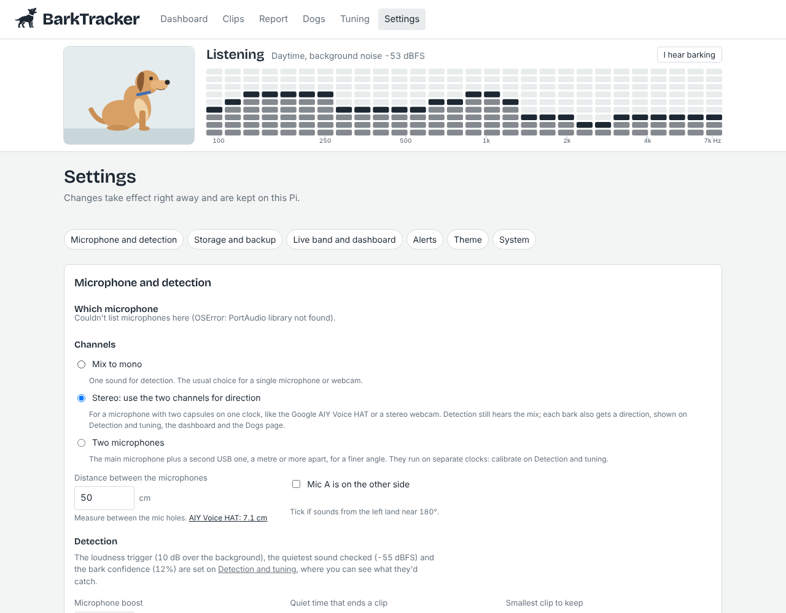

# BarkTracker

A Raspberry Pi 4 that listens for barking, logs when it happens and for how long, saves a clip of each episode, and learns to tell dogs apart. When a neighbor's dog is the problem, it turns the log into a clean, printable complaint report (or CSV) that cites your local noise ordinance. Everything runs on the Pi; the dashboard is a web page on your home network.



## What it does

- **Automatic detection.** A cheap loudness gate wakes Google's [YAMNet](https://www.kaggle.com/models/google/yamnet) sound classifier only when something loud happens, so the Pi idles in a quiet house and still runs a proper model on every candidate sound.
- **Episodes, not just barks.** Barks less than 8 s apart (configurable) are grouped into one episode with a start time, duration, bark count and peak level.
- **Clips for review.** Each episode is saved as a WAV with 2 s of lead-in and lead-out. The clip page shows a spectrogram with every bark marked; click a bark to hear it alone.
- **Which dog.** Label a few barks per dog in the dashboard and new barks are matched to the closest voice automatically. Mark false alarms as "Not a bark" and similar sounds get ignored from then on.
- **Live band on every page.** A picture that matches what's happening (a napping dog during quiet hours, a sitting dog in the daytime or when there's noise without barking, a barking dog the moment a bark is detected) next to a live EQ of the microphone, labelled in Hz (100 Hz to 7 kHz, log scale; most barks sit between 300 Hz and 3.5 kHz). Each column's top cell is the bright peak and the stack under it is half strength, so the tops read as a line of sound; bars fall with gravity and peaks hang briefly. It's monotone in the site's colors normally and switches to caution yellow while a dog is barking, with optional red BARK words popping in at random sizes and angles. It updates 6 times a second while quiet and 20 while barking. When the sound model recognizes something else with at least 80% certainty, a small note names it ("Hearing a car", "Hearing a lawn mower", "Hearing people talking"). Use your own photos, GIFs or video loops. Click the picture for a full-screen view you can leave on a spare screen or tablet.
- **Detection and tuning page.** A live, scrolling spectrogram with the sound level, background and trigger lines, and a tag on every sound the detector considered saying what it decided and why. With two microphones, a bearing chart sits on top: the live EQ wrapped around a half-circle, one bar per wedge of direction. Press **I hear barking** there when the Pi misses barking and the last 15 to 60 seconds are saved for review.
- **Browser tab.** The tab icon is just the dog, black on a light tab bar and white on a dark one. While barking is happening it turns the theme's alert color and the title reads "BarkTracker - Barking Detected".
- **Dashboard.** Plain-language daily summary, a 24-hour timeline coloured by dog, two-week totals, an hour-by-weekday heatmap, where barking comes from (with two microphones), and how many clips are waiting for review.
- **Your local rules.** Enter the animal-noise rule that applies where you live (start from a preset or the "Anytown, USA" placeholder), your quiet hours, and the rules incidents are checked against: sustained barking, quiet hours, on-and-off barking within a window, frequent days, habitual patterns. Add as many as you need from the **+ Add rule** menu.
- **Complaint reports.** Per dog or per household, for any date range: print or save as PDF, or download incidents, daily totals or every bark as CSV, the audio as a zip, or everything in one zip.
- **Which dog, where from.** Dogs are grouped by household. Each one shows its voice, where it barks from and its rhythm (pauses between barks, bursts). Dogs the Pi keeps hearing but can't match show up as "Dogs you haven't named", with examples to listen to.
- **Alerts and themes.** Alerts to ntfy, Discord, Slack or any webhook when a clip ends, while barking goes on, or as a daily or weekly summary. Every color, display behavior and live band picture is part of a theme you can switch, edit, download and share.
- **Unattended.** systemd service, crash recovery for half-written clips, clip retention and a disk cap, optional login, USB backups.











## Hardware

| Part | Notes |
|---|---|
| Raspberry Pi 4 (2 GB or more) | The target. Use **64-bit** Raspberry Pi OS (Bookworm or later, Lite is fine) so the YAMNet runtime installs. A YAMNet check takes tens of milliseconds and only runs on loud sounds, so the Pi stays mostly idle. |
| USB webcam with a microphone, e.g. Logitech C920 / C922 / Brio | Picked automatically (`audio.device: auto`). The stereo mics are mixed to mono, and if the webcam won't record at 16 kHz Barktracker uses its native rate (often 32 or 48 kHz) and resamples. Any other USB mic works too. |
| microSD 32 GB+ or USB SSD | About 2 MB per minute of clip audio. |
| Official Pi 4 power supply | Webcams draw extra current; under-powered Pis drop USB audio. |

Point the webcam toward where the barking comes from (a window facing the neighbor's yard works well), away from fans and the fridge. Webcams apply automatic gain, so leave the microphone boost at 0 unless barks read quieter than -35 dBFS on the Detection and tuning page. Microphones without automatic gain, such as the AIY Voice HAT, need a boost: [docs/MICROPHONES.md](docs/MICROPHONES.md) lists the microphones tested so far with their starting settings, and how to work them out for a new one.

Timestamps matter for complaints. The Pi 4 has no battery-backed clock, so keep it on the network; Settings → System and every report say whether the clock is synchronized to internet time. After a boot the clock can be minutes off until the time server answers; when it then jumps by more than 30 seconds, everything logged since the boot is moved to the corrected time and its clips renamed to match (the log says "Clock jumped").

## Install

```bash
git clone <this repo> barktracker && cd barktracker
./scripts/install.sh
```

The installer sets up a Python venv, the TFLite runtime, downloads YAMNet (~4 MB), writes `config.yaml` with your Pi's time zone, and starts the `barktracker` service. Open `http://<pi-address>:8080`.

### Check the microphone

```bash
sudo systemctl stop barktracker
.venv/bin/python -m barktracker devices     # find your mic
.venv/bin/python -m barktracker level       # live meter; bark or clap near it
sudo systemctl start barktracker
```

Calm background noise should read around -60 to -45 dBFS and a bark well above -30. With several USB audio devices plugged in, pick the one to use under **Settings → Microphone and detection** (it switches in about a second, no restart), or set `audio.device` in `config.yaml` to part of its name (e.g. `C920`). The **Detection and tuning** page shows the live level, the learned background noise and the trigger line.

## Using it

The pages, in menu order:

- **Dashboard.** The day at a glance (pick another day with the arrows), the last two weeks, when barking happens by weekday and hour, and, with two microphones, a chart of where it comes from. Quiet hours are striped. The chips at the top (Dogs or Households) narrow everything to the dogs you pick; your choice is remembered in this browser. The card at the bottom says how many clips need review and how many are new since you last opened Clips.
- **Clips.** Every recording, newest first. Select one and it opens in place: a spectrogram with every bark marked, the player, who's barking, a note. Label the whole clip, or select barks on the spectrogram (shift-select for several) and label those; clips with two dogs are best labelled bark by bark. **Unknown dog** keeps it as barking without crediting anyone or teaching the Pi anything. While a clip is open, ↑ and ↓ (or k and j) move to the next one. Each row says how it was decided: **Manual** (you labelled or reviewed it), **Auto** (found and matched automatically, with good confidence) or **Unreviewed** (nobody has checked it and something is uncertain: a bark score under 60%, a dog it couldn't name, or a match under 75%; adjustable under Settings → Advanced). The list starts with the newest 50 and fetches more as you scroll; the filters cover every clip and start the list over. Opening a clip counts as reviewing it. **Hide clips that aren't barking** is on by default; untick it to review, restore or clear out the clips marked "Not a bark".
- **Report.** Your local rules at the top (see [Noise ordinance](#noise-ordinance)), then who and when to report on, then the printable report.
- **Dogs.** Dogs grouped by household (the address they live at; dogs at the same address are one household, and a household report covers all of them). Set each dog's color, size, breed, owner and description. **Details** opens a page for one dog: barking per day, time of day, a weekday-by-hour density map, its voice (pitch, tone and bark-length spread, and its most typical barks to see and hear), where it barks from, its rhythm and its longest clips. After 3 labelled barks per dog, new barks are matched automatically. Barks it isn't sure about stay "Unidentified". **Dogs you haven't named** lists groups of unidentified barks that sound alike (and, with two microphones, come from the same way) and keep turning up on several days; play the examples, then name it, say which of your dogs it is, or mark it "Not a dog". That labels every bark in the group, not just the examples.
- **Tuning.** See [Detection and tuning](#detection-and-tuning).
- **Settings.** See [Settings](#settings).

**False alarms.** Mark a sound "Not a bark" and it drops out of the stats; after a few examples, similar sounds are filtered out before they're logged. Deleting just the audio of those clips frees disk space and keeps what was learned.

**How barking time is counted.** A clip runs from the start of its first bark to the end of its last, so the short pauses between barks count; a pause longer than "Quiet time that ends a clip" (Settings → Microphone and detection) ends it, and that silence isn't counted. Pre- and post-roll audio is not counted. "Last two weeks" adds up the clips that started each day.

**Clip by clip, or bark by bark?** Clips are the unit you review (you need the sound around a bark to judge it), but every bark is stored on its own with its dog, time and direction. That's what the Dogs page uses for each dog's rhythm, what the report's "Every bark" CSV lists, and what the dashboard charts count.

## Settings

Each section is a card that opens when you need it (Open all / Close all at the top). Everything takes effect immediately, no restart needed:

- **Microphone and detection:** which microphone, **Mix to mono**, **Stereo** (two capsules on one device, for direction) or **Two microphones**, the distance between them, microphone boost, quiet time that ends a clip, smallest clip, how calm the background must be for the live band's daytime nap (it depends on the microphone, so it's here rather than in the theme), ignoring learned false alarms, and how dogs are told apart (labels needed, match confidence, using direction). The three detection levels themselves are set on the Tuning page, where you can see their effect.
- **Storage and backup:** disk usage, how much audio recent barking adds per day and how many days the cap holds, clip retention, disk cap, clip length, pre and post roll; and the USB backup drive (see [Backup and restore](#backup-and-restore)).
- **Alerts:** a list you add to and remove from, like alarms on a phone. Each alert goes to one place (ntfy, Discord, Slack, or a JSON webhook for Home Assistant and the like) when its condition is met: a clip ends (optionally only if it meets a report rule, or lasts long enough), barking has gone on for N minutes (once per clip, while it's still happening), or a daily or weekly summary at a set time. Each can be limited to quiet hours and to certain dogs. **Test** sends a sample.
- **Theme:** pick a theme, duplicate one to make your own, and change everything about the look: name, light or dark, corner roundness and alert color; the **Live band** (daytime napping, "Hearing a car" notes and how sure the model must be, BARK words, and the nap, sit and bark pictures, with a link to the calm threshold); the colors (light and dark); and behavior (tab alert, calm motion). Built-in themes can't be changed, but your own pictures (used by any theme without pictures of its own) can always be added and removed there. A theme can carry its own live band pictures: copy the current ones in, and the theme then downloads as a .zip with them. Upload a .json or .zip someone shared. Your themes are stored in `data/themes/` and backed up with everything else.
- **Advanced (debug):** the numbers normally fixed in the code, such as when a clip counts as Unreviewed (bark score under 60%, a match under 75%), how loud a sound must be to show on the bearing chart, how direction weighs into matching, live band timing, how big a clock jump gets corrected, and how "Dogs you haven't named" groups barks. Changed values are marked; one button puts them all back.
- **System:** the Pi's model, temperature, power warnings, load, memory, disk and uptime; whether it's listening and on what; detector and clock status; download the whole log as CSV.

Changes are stored on the Pi as overrides of `config.yaml`; "Restore config.yaml values" undoes them.

## Heartbeat pictures

The band shows one of three pictures:

| Picture | When | Folder |
|---|---|---|
| Napping | Calm (no noise above the background) during quiet hours, or in the daytime when the background noise is below the daytime-nap threshold (-50 dBFS by default; Settings → Microphone and detection) | `data/media/quiet/` |
| Sitting | Daytime with background noise above that threshold, or any sound at least 8 dB above the background noise (or louder than -38 dBFS) without barking | `data/media/active/` |
| Barking | A bark is detected, for as long as the episode lasts | `data/media/bark/` |

Switching between napping and sitting waits 4 seconds so a passing car doesn't flip it; barking switches immediately. Put your own files in those folders or upload them under Settings → Theme → Live band; if a folder has several, one is picked at random. JPG, PNG, GIF, WebP, SVG, MP4 and WebM all work. Until you add your own, the built-in drawings are used.

## Noise ordinance

The **Local rules** panel at the top of the Report page holds the rule your reports cite and the rules incidents are checked against. A new install starts with placeholder wording ("City of Anytown, USA", 555 phone numbers). Choose a preset under **Start from**, or type in your own code section, the rule in plain words, a link, the penalty, quiet hours and where to report (add as many contacts as you like). If your city has later weekend hours, tick **Different quiet hours at weekends**: overnight hours then count as weekend on Friday and Saturday nights, daytime hours on Saturdays and Sundays. The panel starts closed; its summary line shows the jurisdiction, quiet hours and how many rules are on. Your own name and contact details go under **Your details**.

**Presets** (pick one and it's loaded; your own details are kept):

- **Burnsville, MN:** City Code [§ 6-2-7](https://burnsville.municipalcodeonline.com/book?type=ordinances#name=6-2-7_Obligation_To_Prevent_Nuisances) makes it a nuisance for an animal to habitually or frequently bark, cry, howl or whimper so it disturbs others, with no minute count and no animal-specific quiet hours. Contacts: police non-emergency dispatch for noise complaints (952-322-2323, 24/7), Burnsville Animal Control at American Boarding Kennels (952-894-3647), City Hall (952-895-4400).

**Rules.** Most codes say "habitually or frequently" without numbers, so these are your documentation criteria, not legal limits. Rename them, change their numbers, switch them off, or add more with **+ Add rule**:

| Rule type | Default | Checks |
|---|---|---|
| Sustained | 10 min | one stretch of barking with no break longer than the allowed break (60 s) |
| Quiet hours | 5 min | barking between the quiet-hours start and end (10 PM to 7 AM) |
| Intermittent | 30 min within 3 hours | barking on and off that adds up within a window, as many cities word it |
| Frequent day | 30 min | barking in one day |
| Habitual pattern | 3 days within 7 | days that meet any other rule |

Check the current code before filing; ordinances change. To add a preset for your city, add an entry to `PRESETS` in `barktracker/ordinance.py` (pull requests welcome).

## Complaint reports

1. On **Dogs**, put each neighbor's dog in its household (address) with the owner and a short description.
2. Label some clips so the dog is identified.
3. On **Report**, choose a dog or a household and a date range. Options: only incidents meeting a rule, and only barks you've personally confirmed (leaving out automatic voice matches).
4. **Print or save as PDF** for a signed log, or download: **Incidents** and **Daily totals** (one clean table each, open directly in Excel or Sheets), **Every bark** (time, dog, how it was identified, bark and match confidence, loudness, direction), **Audio** (each incident's recordings, named by incident number) or **Everything** (the recordings, every table, the rule text and the report data in one zip).

The printed report includes: who and what the complaint is about, the period, your contact details, the ordinance text and source, a summary, the rules with counts, daily totals, a numbered incident log (start, end, length, barks, whether a person confirmed the dog, rules met, your notes), how the recording was made, where to report, and a signature line.

## How detection works

```
mic ─► 50 ms frames ─► noise floor tracker + onset gate
                              │ (only on a sudden loud sound)
                              ▼
               ~1 s window ─► YAMNet ─► P(bark) ≥ 0.35 ? ─► dog matcher ─► episode + clip
```

- **Exact bark positions.** The trigger often fires on noise just before a bark, and the model only says a bark is somewhere in the next second. So each bark is pinned to its actual attack in the bark frequency band (300 to 3500 Hz) at 10 ms resolution.
- **Second pass after each episode.** When an episode ends, a background pass re-scans the whole clip: it finds every attack, judges each one on its own with neighbouring sounds faded out, and rewrites the episode's barks with exact positions and lengths, adding barks the live pass missed and removing duplicates. Distant barks over road noise often score low with the sound model, so inside an episode it already confirmed, the second pass also counts strong attacks that sound like a dog or match the shape of the clip's other barks, as long as they're about as loud; a quiet echo right after a bark stays part of that bark. Labels you've already given move with their bark. Existing clips are re-scanned automatically after updating; `python -m barktracker refine --all` redoes everything.
- The noise floor adapts downward quickly and upward slowly, so a fan switching on raises the threshold over a few minutes without hiding barks.
- YAMNet scores 521 AudioSet classes; Barktracker combines *Bark*, *Bow-wow*, *Yip*, *Dog*, *Howl*, *Growling* and *Whimper (dog)* with weights. In testing on real recordings it caught all dog clips and ignored birds, rain and fireworks.
- Without YAMNet (32-bit OS, no runtime) a simple acoustic detector is used. It catches barks but also some claps, door slams and fireworks; the "Not a bark" filter helps.
- **Voice profiles.** Each dog's card shows its typical bark pitch, tone (brightness), bark length and spectral shape from its confirmed barks, and how often the Pi tells it apart from your other dogs (checked against your own labels).
- Dog matching uses a per-bark voice descriptor (spectral shape, brightness, pitch, length) and a nearest-neighbour vote over your labels. It works well for dogs that sound different (big vs. small, different breeds). Two dogs of the same breed and size will often stay unidentified; that's a limit of the audio, not something more labels fully fix.

## Detection and tuning

Every sound passes three checks before it's logged as a bark:

1. **Loud enough.** It rises "Loudness trigger" dB over the background and is louder than "Ignore sounds quieter than".
2. **Bark-like.** The sound model is at least "Bark confidence needed" sure it's barking (yips count).
3. **Not a known false alarm.** It doesn't match the clips you marked "Not a bark".

The **Tuning** page (Detection and tuning) shows the last minute live: a spectrogram, the level against the background and trigger lines, and a tag for every sound the detector considered: counted (green), too quiet (dashed, with how far over the background it got), not bark-like enough (with the score, or what it sounded like instead) or filtered. Point at or tap a tag for the reason in plain words. While the page is open, sounds that were too quiet are also scored by the sound model, so you can see whether a quieter dog would pass the other checks.

The **Detection levels** sliders recolor the tags to show what other settings would have counted, before you save anything. **Use these settings** applies them immediately.

**I hear barking.** When you hear barking the Pi didn't log, press the button on the Tuning page. The last 15, 30 or 60 seconds are saved as a capture. Open it from **Captures to review**: every sound in it is listed with its level, how far it rose over the background, its bark score, what it sounded like and which check stopped it. Select the barks and choose the dog (or Unknown dog, or let the Pi guess): they're added to the log as an episode, and the labels teach dog matching that voice. "No barking here" discards the audio but keeps the measurements.

**Suggestions.** From all the barks you've marked in captures (and the sounds you didn't mark), the Tuning page works out the gentlest trigger, quiet level and confidence that would have counted them, how many of them that catches, and how many other sounds it would also let through. "Try these above" loads them into the sliders.

Captures you don't review are removed with the clip retention.

## Direction (two microphones)

Under **Settings → Microphone and detection → Channels**, choose **Stereo** or **Two microphones** and BarkTracker also works out which way each sound came from. Detection itself is unchanged: it still hears the mix.

- **Stereo:** two capsules on one device and one clock, like the AIY Voice HAT (7.1 cm apart) or a stereo webcam (a few centimetres). Timing is exact; the closer the capsules, the coarser the angle. Measure the spacing and enter it.
- **Two microphones:** the main microphone plus a second USB one, ideally a metre or more apart for a finer angle. They run on separate clocks, so press **Calibrate** on the Tuning page and clap once straight ahead (90°); it drifts, so recalibrate now and then.

The direction comes from the time difference between the microphones (GCC-PHAT on the bark band): 0° toward mic A, 180° toward mic B, 90° straight ahead (or behind; two microphones can't tell front from back, so mount them against a wall). Where it shows up:

- **Tuning:** the bearing chart, an LED bar per wedge (10°, 15° or 30°) that rises with how loud the sound from that way is over the background and falls back under gravity; bars turn the alert color while a dog is barking. Numbered dots mark the sounds the detector decided about, and the same numbers ride on the tags in the live channel. The chart only scans while the page is open, so it costs nothing otherwise.
- **Dashboard:** where the last 7 days' (or this day's, or 30 days') barks came from, stacked by dog.
- **Full-screen live view:** the bearing chart sits under the live band.
- **Clips:** each clip's typical direction, and each bark's on hover.
- **Dogs:** where each dog usually barks from. With **Use direction when matching** on, a bark from where a dog usually barks counts toward that dog. It's learned only from barks you labelled, so a wrong guess can't teach itself, and unlabelled barks are re-matched every hour as directions come in.

Two microphones give a direction, not a distance. Loudness hints at distance, but a dog's barks vary by ±10 dB on their own, so treat it as a weak clue. Directions are kept for a year.

### Google AIY Voice HAT (v1)

The original AIY Voice Kit HAT (the larger black board) has two MEMS microphones 7.1 cm apart on one clock, which suits the stereo mode well.

1. Fit the HAT and its microphone board, then run `./scripts/setup-voicehat.sh`. It adds `dtoverlay=googlevoicehat-soundcard` to `/boot/firmware/config.txt` (keeping a backup). Reboot.
2. Run `./scripts/setup-voicehat.sh check`. It lists sound cards and records 3 seconds, reporting each mic's level. Both should be similar; a dead channel means a loose ribbon.
3. In **Settings → Microphone and detection**, check the Voice HAT is the microphone (it's picked automatically when nothing else is set), choose **Stereo**, press **AIY Voice HAT: 7.1 cm**, and save. Clap at each end of the board on the Tuning page: mic A's end should light near 0°. If it's mirrored, tick **Mic A is on the other side**.
4. Set **Microphone boost** to +18 dB and **Ignore quieter than** to -62 dBFS. The HAT has no hardware gain, so distant barks record around -45 dBFS without the boost. Details and measurements are in [docs/MICROPHONES.md](docs/MICROPHONES.md).

With direction on, BarkTracker records at the card's native rate (48 kHz on the HAT) for finer timing, and resamples for detection as before. The speaker amp, button and LED aren't used.

For an outdoor box: mount it flat against a wall so the "behind" half of the circle is blocked, which removes the front/back ambiguity. Cover the mic holes with an acoustic membrane vent (the kind used on outdoor cameras) rather than leaving them open, add a foam wind screen, and keep the Pi inside the box with the HAT, because I2S mic leads don't like long cables. Leave a drain hole at the lowest point and expect condensation on cold mornings.

## Backup and restore

SD cards wear out. Point Barktracker at a USB drive and it keeps a copy of everything you'd hate to lose: the log database (every episode and bark, your dogs and neighbor details, every label you've given and the bark features behind them, which is all the training data for dog matching and "Not a bark"), your settings, ordinance and contacts, the recordings, your live-band pictures and `config.yaml`.

**Set up the drive (once).** Plug it into the Pi and run:

```bash
./scripts/setup-usb-backup.sh            # lists USB drives
./scripts/setup-usb-backup.sh /dev/sda1  # mounts that one at /mnt/barktracker-backup on every boot
```

Nothing is erased; exFAT, FAT32 and ext4 all work (ext4 copes best with power cuts). Then set **Settings → Storage and backup → Backup folder** to `/mnt/barktracker-backup` and save. On Raspberry Pi OS with a desktop you can instead pick the auto-mounted drive (under `/media/...`) from the list of drives on that page.

**What happens.** Every 24 hours (adjustable) Barktracker writes a consistent snapshot of the database to `barktracker-backup/db/` on the drive (keeping the newest 7) and copies any new recordings and pictures. Only what changed is copied, so it's quick after the first run. A recording is removed from the drive only after the clip retention rules delete it from the log; a recording that disappears from a failing SD card is kept. The status line shows when the last backup ran and what it held. "Safely remove drive" unmounts it so you can unplug it; plug it back in and the next backup mounts it again.

Barktracker refuses to back up onto the SD card itself (what an unmounted drive's folder really is), and won't write over a drive holding a different install's backup.

**Restore onto a new Pi.** Install Barktracker as usual, set up the drive with `setup-usb-backup.sh`, then on **Settings → Storage and backup → Restore** press **Look for backups**, choose a database copy (newest is preselected), type RESTORE and press **Restore and restart**. The recordings are copied to the new SD card, the service restarts with the restored log, settings and training data, and backups carry on to the same drive. The database it replaced is kept in `data/pre-restore-<time>/`. From a terminal instead:

```bash
sudo systemctl stop barktracker
.venv/bin/python -m barktracker restore /mnt/barktracker-backup     # --snapshot NAME, --no-clips
sudo systemctl start barktracker
```

Without a USB drive, **Download database** saves the log, labels and settings (no recordings) to your computer, and **Restore from a downloaded database file** loads it back.

## Configuration

Everything is in `config.yaml`, with comments: see [`config.example.yaml`](config.example.yaml). Common tweaks:

| Want | Change |
|---|---|
| Fewer false alarms | `detection.bark_threshold: 0.5`, or `min_episode_barks: 2` |
| Catch distant/quiet barks | lower `trigger_db` to 6–8, add `audio.gain_db: 6` |
| Split episodes more finely | `detection.episode_gap: 4` |
| Keep clips longer | `clips.retention_days`, `clips.max_disk_mb` |
| Require login | `web.username` and `web.password` |
| Phone alert for long barking | `notify.webhook_url: https://ntfy.sh/<your-topic>` |
| Back up to a USB drive | `backup.path: /mnt/barktracker-backup` (see above) |

Restart after editing: `sudo systemctl restart barktracker`.

## Command line

```bash
python -m barktracker run                  # what the service runs: listen + dashboard
python -m barktracker run --file x.wav     # replay a recording through the live pipeline
python -m barktracker ingest x.wav --start 2026-10-24T08:00   # log an existing recording
python -m barktracker devices | level | retrain
python -m barktracker refine [--all]      # re-scan saved clips so bark marks line up exactly
python -m barktracker backup [--to DIR]    # back up now
python -m barktracker restore DIR          # restore a backup onto this install (stop the service first)
python -m barktracker demo                 # two weeks of synthetic barking to try the dashboard
```

## API

The dashboard uses a small JSON API, documented at `/api/docs`. Useful bits: `/api/status`, `/api/summary?days=14`, `/api/episodes`, `/api/episodes/{id}/audio`, `/api/report?dog=1&from=2026-10-01&to=2026-10-31`, `/api/report.csv` (same parameters, plus `kind=daily`), `/api/report/clips.zip`, `/api/ordinance`, `/api/settings`, `/api/live` (or `/api/live/stream` for server-sent events: 6 per second while quiet, 20 while barking), `/api/media`, `/api/backup` (status, `/run`, `/inspect`, `/restore`, `/database.db`).

## Development

```bash
python3 -m venv .venv && .venv/bin/pip install -r requirements.txt pytest httpx ai-edge-litert
./scripts/download_model.sh
.venv/bin/python -m pytest
.venv/bin/python -m barktracker -c config.example.yaml demo && .venv/bin/python -m barktracker -c config.example.yaml run --no-audio
```

No build step: the dashboard is plain HTML/CSS/JS in `barktracker/static/` and works without internet (the font is bundled).

## Credits

YAMNet by Google (Apache 2.0). Bricolage Grotesque by Mathieu Triay (SIL OFL 1.1, `barktracker/static/fonts/OFL.txt`).
